# 🛡️ SOC Home Lab: Detecting an RDP Attack with Wazuh SIEM

A hands-on Blue Team lab where I built a small SOC environment, simulated a realistic attack chain against a Windows endpoint, and investigated it end-to-end in **Wazuh SIEM**, from reconnaissance to privilege escalation, with every finding mapped to **MITRE ATT&CK**.

> **Attack chain:** Nmap reconnaissance → RDP brute force → successful remote logon → local account creation → added to Administrators

---

## 📑 Table of Contents

1. [Project Overview](#-project-overview)
2. [Lab Architecture](#-lab-architecture)
3. [Setting Up the Wazuh Server](#-setting-up-the-wazuh-server)
4. [Connecting Windows 10 to Wazuh](#-connecting-windows-10-to-wazuh)
5. [Baseline Before the Attack](#-baseline-before-the-attack)
6. [Phase 1: Reconnaissance (Nmap)](#-phase-1-reconnaissance-nmap)
7. [Phase 2: RDP Brute Force](#-phase-2-rdp-brute-force)
8. [Phase 3: Successful Remote Logon](#-phase-3-successful-remote-logon)
9. [Phase 4: Persistence and Privilege Escalation](#-phase-4-persistence-and-privilege-escalation)
10. [Attack Timeline](#-attack-timeline)
11. [MITRE ATT&CK Mapping](#-mitre-attck-mapping)
12. [Incident Response Recommendations](#-incident-response-recommendations)
13. [Lessons Learned and Detection Gaps](#-lessons-learned-and-detection-gaps)

---

## 🎯 Project Overview

The goal of this project is to think like a **SOC Tier 1 analyst**: not just install a SIEM, but use it to detect, investigate, and explain an attack using real Windows Security events.

**What I did:**
- Deployed a Wazuh SIEM server and enrolled a Windows 10 endpoint as an agent
- Simulated an attacker from Kali Linux performing recon, brute force, and post-exploitation
- Hunted the activity in Wazuh using alerts, raw event logs, and targeted searches
- Mapped each stage to MITRE ATT&CK and identified detection gaps

**Tools used:**

| Tool | Purpose |
|------|---------|
| Wazuh 4.14.8 (OVA) | SIEM: log collection, correlation, alerting, MITRE mapping |
| Windows 10 Pro | Victim endpoint with Wazuh agent |
| Kali Linux | Attacker machine |
| Nmap | Network and service discovery |
| Oracle VirtualBox | Virtualization platform |

---

## 🏗️ Lab Architecture

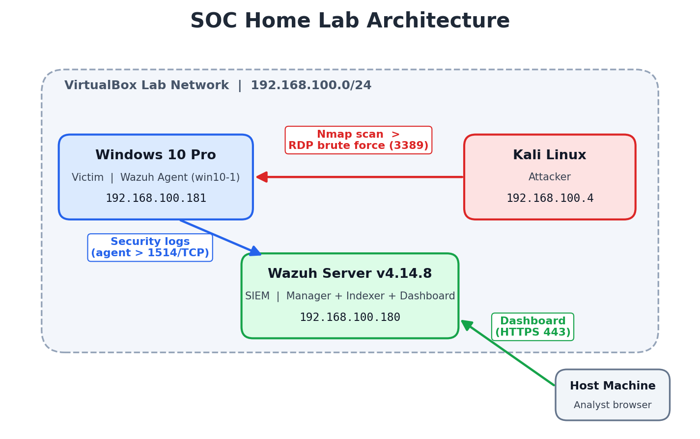

| Machine | Role | IP Address |
|---------|------|------------|
| Kali Linux | Attacker | `192.168.100.4` |
| Windows 10 Pro (`win10-1`) | Victim + Wazuh Agent | `192.168.100.181` |
| Wazuh Server | SIEM (Manager, Indexer, Dashboard) | `192.168.100.180` |
| Host Machine | Analyst workstation (accesses the dashboard) | — |

All three virtual machines run on the same isolated VirtualBox network (`192.168.100.0/24`). The Windows agent ships its security logs to the Wazuh server, and I access the dashboard from the host machine's browser.

---

## ⚙️ Setting Up the Wazuh Server

To keep the setup simple, I used the **official Wazuh OVA** (a pre-built virtual machine that includes the manager, indexer, and dashboard in one appliance), downloaded from the Wazuh website and imported into VirtualBox.

After booting the VM and logging in, the Wazuh server was up and running:

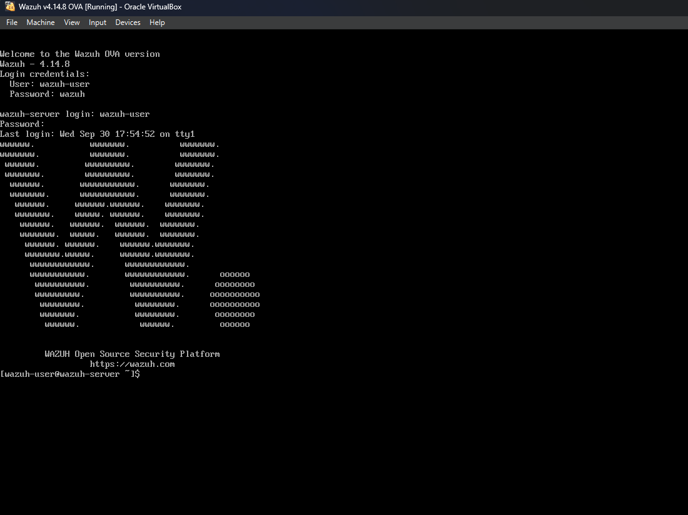

I then opened the dashboard from the host machine at `https://192.168.100.180`:


> ⚠️ The OVA ships with default credentials. They are acceptable in an isolated lab but **must be changed** in any real environment.

Once logged in, the overview page shows the agent summary, alert severity counts, and the available security modules:

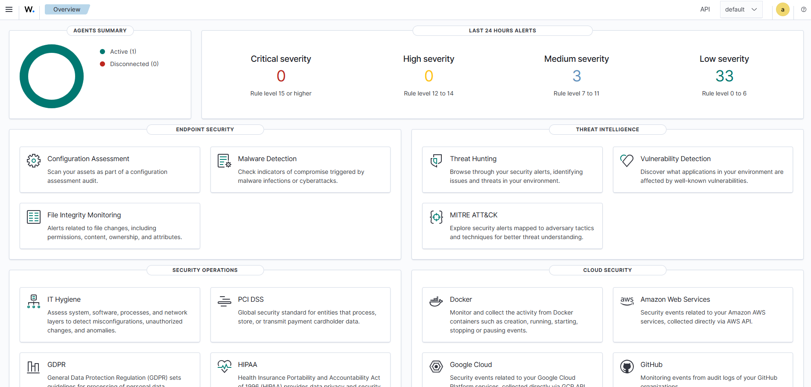

---

## 🔗 Connecting Windows 10 to Wazuh

I enrolled the Windows machine using the built-in **Deploy new agent** wizard in the dashboard (following the official Wazuh documentation):

1. **Endpoints → Deploy new agent**, select **Windows (MSI)**
2. Enter the server address (`192.168.100.180`) and an agent name (`win10-1`)
3. Copy the generated PowerShell command and run it on Windows as Administrator
4. Start the agent service:

```powershell
NET START WazuhSvc
```

The agent appeared as **active**, confirming that Windows logs are reaching the SIEM:

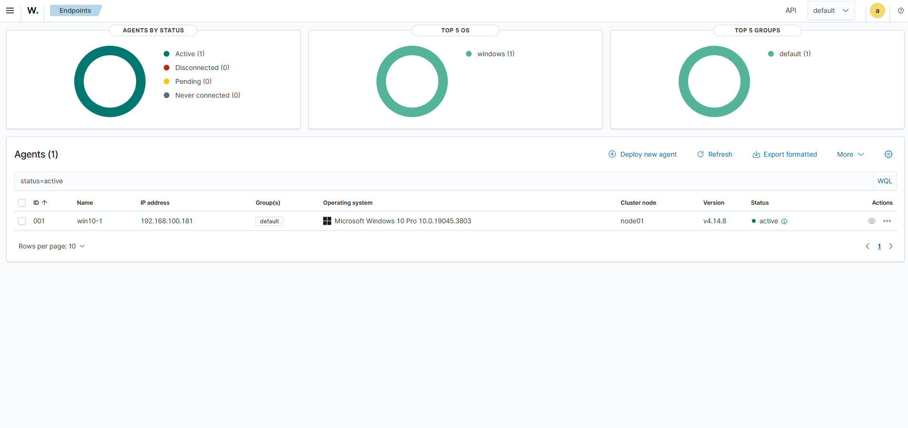

---

## 📊 Baseline Before the Attack

Before launching any attack, I captured what "normal" looked like for this endpoint. This is important: an analyst needs a baseline to recognize what changed.

The MITRE ATT&CK module shows the full framework for the agent:

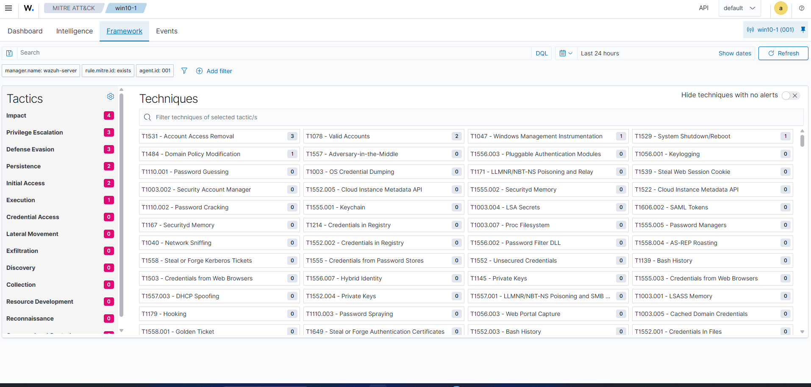

Filtering to techniques that actually have alerts, only a few low-noise items from normal lab activity appear (logons, a system restart):

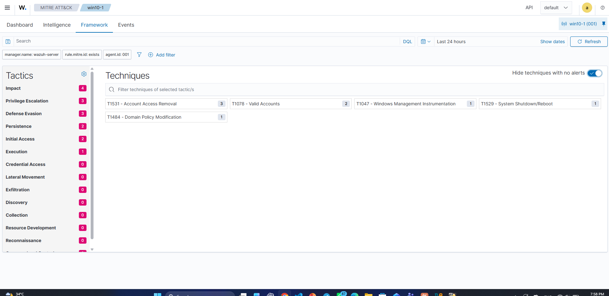

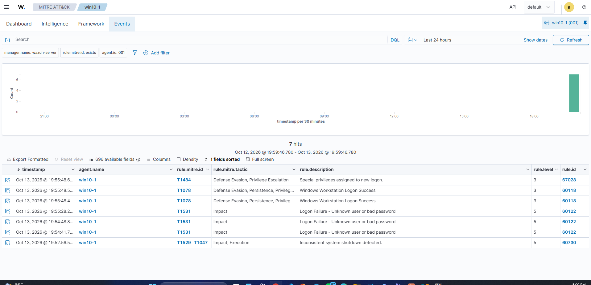

**Baseline:** 7 alerts, all low severity (level 3–5). Keep this picture in mind for comparison after the attack.

---

## 🔍 Phase 1: Reconnaissance (Nmap)

**Attacker action:** From Kali, I ran a service version scan against the Windows host:

```bash
nmap 192.168.100.181 -sV
```

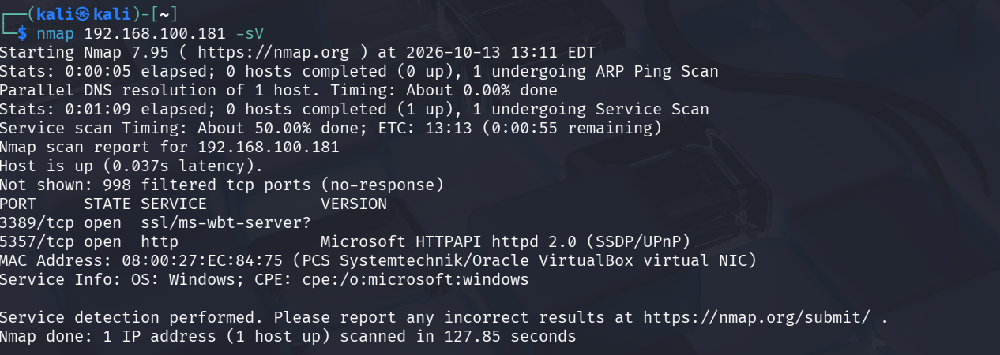

**Findings:**

| Port | State | Service |
|------|-------|---------|
| 3389/tcp | open | **RDP** (ms-wbt-server) |
| 5357/tcp | open | Microsoft HTTPAPI (SSDP/UPnP) |

998 ports were filtered (Windows Firewall is active), but **RDP on port 3389 was exposed**, which became the attacker's entry point.

**SOC perspective:** The scan itself generated **no alert in Wazuh** (Reconnaissance = 0). This is expected: the Wazuh agent monitors host logs, not network traffic. Detecting scans requires a network IDS such as Suricata. See [Detection Gaps](#-lessons-learned-and-detection-gaps).

---

## 🔨 Phase 2: RDP Brute Force

**Attacker action:** With RDP exposed, the attacker launched a password brute-force attack against the Windows account `VICTEM1`.

**Detection:** Every failed attempt generated Windows **Event ID 4625** (failed logon), which Wazuh raised as **Rule 60122 – "Logon Failure - Unknown user or bad password"** (level 5). The burst of failures within about one minute (20:18 – 20:19) is the classic brute-force pattern:

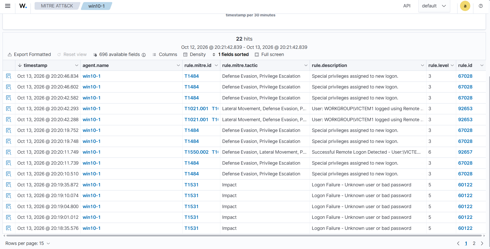

Drilling into the technique view shows the failed-logon hits together. Notice the tactic counts on the left, which have grown sharply compared to the baseline:

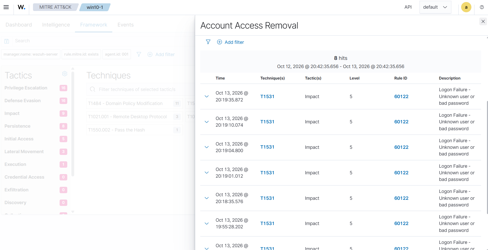

**Analyst note:** Wazuh's default rule maps these failures to **T1531 (Account Access Removal)**. In context, the more accurate technique is **T1110.001 – Brute Force: Password Guessing**. Mappings provided by a tool are a starting point; the analyst must validate them against the actual behavior.

---

## 🚪 Phase 3: Successful Remote Logon

**Attacker action:** Shortly after the failures, the brute force succeeded and the attacker logged in over RDP.

**Detection:** In the same alert list (above), right after the failures, two new rules fire:

| Time | Rule ID | Level | Description |
|------|---------|-------|-------------|
| 20:20:11 | 92657 | 6 | Successful Remote Logon Detected (NTLM) |
| 20:20:42 | **92653** | 3 | `WORKGROUP\VICTEM1` logged using **Remote Desktop Connection (RDP) from 192.168.100.4** |

**Failures followed by a success from the same source** is a strong indicator that the brute force worked. The RDP technique view (T1021.001) confirms the attacker's IP:

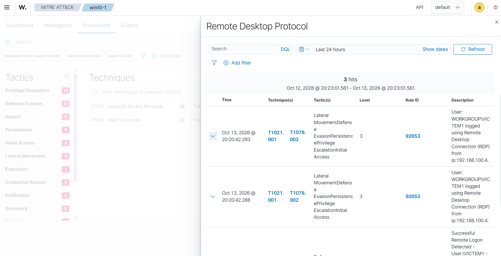

### Investigating the raw event (Event ID 4624)

To confirm who logged in and from where, I opened the raw Windows event behind the alert:

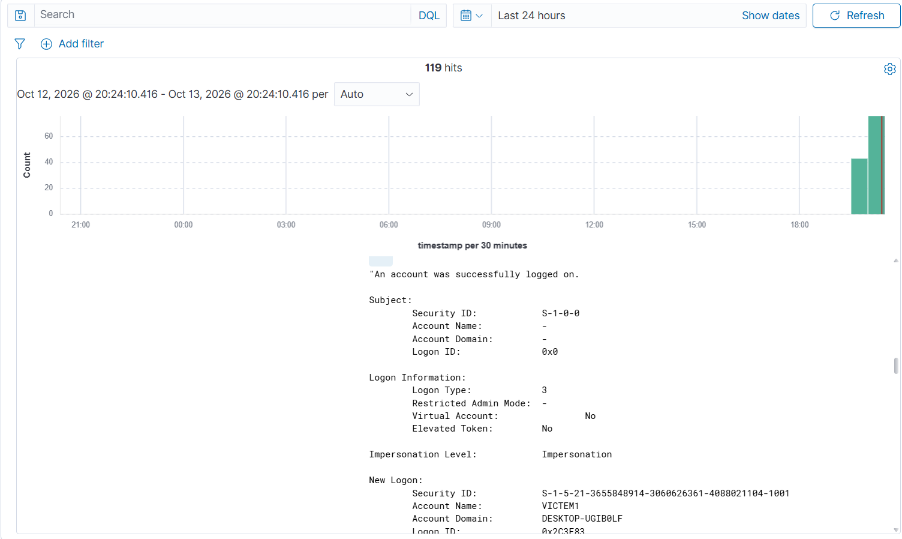

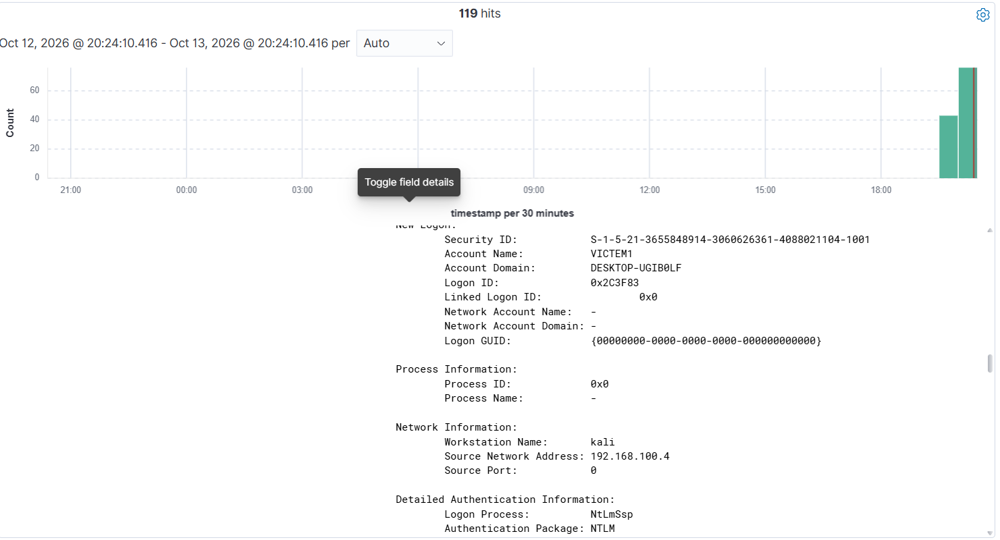

| Field | Value | Meaning |
|-------|-------|---------|
| Account Name | `VICTEM1` | The compromised account |
| Logon Type | `3` (Network) | RDP with Network Level Authentication (NLA) first authenticates as a network logon |
| Workstation Name | **`kali`** | The connecting machine identifies itself as Kali |
| Source Network Address | **`192.168.100.4`** | The attacker's IP |
| Authentication Package | `NTLM` | Authentication over NTLM |

The event proves that the successful logon came from the attacker machine, not from a legitimate user.

**Analyst note:** Rule 92657 is tagged **T1550.002 (Pass the Hash)** because it fires on NTLM network logons. Here, the evidence points to a password obtained through brute force, not a reused hash, so this mapping is a heuristic flag that needs analyst validation.

---

## 👤 Phase 4: Persistence and Privilege Escalation

**Attacker action:** About **10 minutes** after gaining access, the attacker created a new local account named `attacker` and added it to the local **Administrators** group, a backdoor that survives even if `VICTEM1`'s password is reset.

**Detection:** Wazuh raised a cluster of account-management alerts, ending with the **highest-severity alert of the whole scenario (level 12)**:

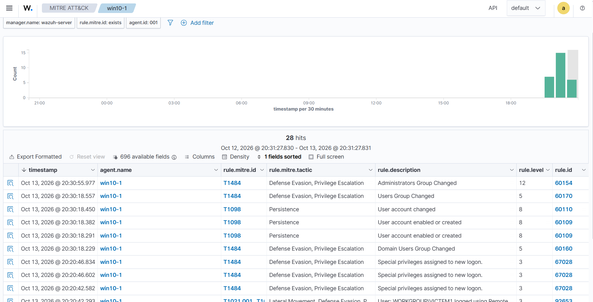

| Time | Rule ID | Level | Description |
|------|---------|-------|-------------|
| 20:30:18 | 60109 | 8 | User account enabled or created |
| 20:30:18 | 60110 | 8 | User account changed |
| 20:30:18 | 60170 | 5 | Users Group Changed |
| 20:30:55 | **60154** | **12** | **Administrators Group Changed** |

### Hunting with targeted searches

To confirm exactly what happened, I searched in **Discover** by Windows Event ID.

**1. Account creation – Event ID 4720**

```
data.win.system.eventID:4720
```

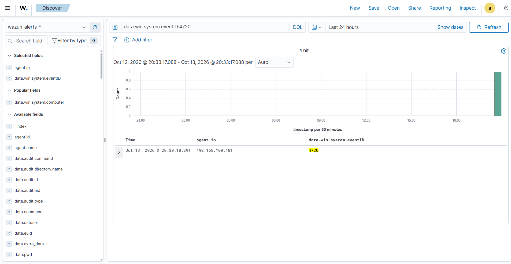

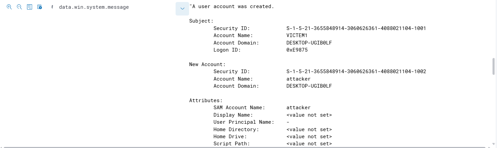

The event shows that `VICTEM1` (the compromised account) **created a new account named `attacker`** (SID ending in `-1002`).

**2. Group membership change – Event ID 4732**

```
data.win.system.eventID:4732
```

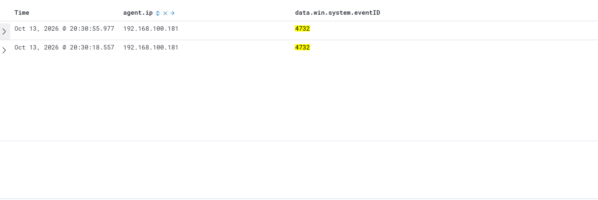

Two hits: one at 20:30:18 (the new account being added to the default Users group) and one at 20:30:55. Opening the second event:

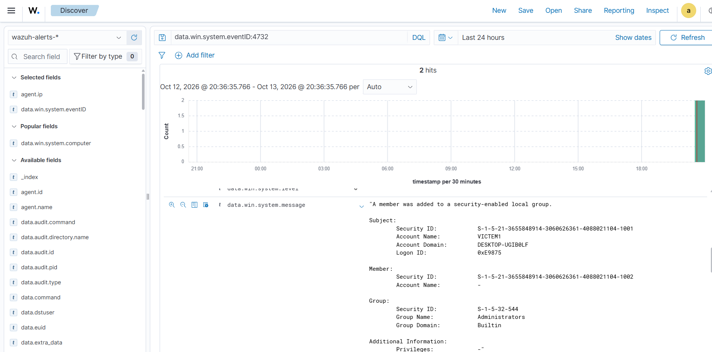

| Field | Value |
|-------|-------|
| Performed by | `VICTEM1` |
| Member SID | `S-1-5-21-...-1002` |
| Group | **Administrators** (`S-1-5-32-544`) |

**Analyst note:** Event 4732 shows the member's **Account Name as "-"**, which is normal. The account is identified by its **SID**. Matching SID `-1002` with the SID from Event 4720 proves the new `attacker` account is the one that was given admin rights. Correlating events by SID rather than by name is a key investigation skill.

### MITRE ATT&CK view after the attack

Compared to the baseline, the MITRE view now shows activity across **Privilege Escalation (16), Defense Evasion (16), Impact (9), Persistence (8), Initial Access (5), and Lateral Movement (3)**, including new techniques such as **T1021.001 (RDP)** and **T1550.002** (visible in the left panel of the [Phase 2 screenshot](#-phase-2-rdp-brute-force)). The baseline showed only a handful of low-severity alerts; after the attack, the endpoint's MITRE picture changed completely.

---

## ⏱️ Attack Timeline

| Time (Oct 13, 2026) | Phase | Evidence | Wazuh Rule |
|------|-------|----------|-----------|
| ~20:11 | Reconnaissance | Nmap scan finds RDP (3389) open | No alert |
| 20:18 – 20:19 | Brute Force | Multiple Event 4625 failed logons | 60122 |
| 20:20:11 | Initial Access | Successful NTLM remote logon | 92657 |
| 20:20:42 | Initial Access | RDP logon as `VICTEM1` from `192.168.100.4` | 92653 |
| 20:30:18 | Persistence | Account `attacker` created (Event 4720) | 60109 |
| 20:30:55 | Privilege Escalation | `attacker` added to Administrators (Event 4732) | **60154 (level 12)** |

**Total time from first failed logon to admin backdoor: ~12 minutes.**

---

## 🗺️ MITRE ATT&CK Mapping

| Tactic | Technique | Observed Activity | Detected? |
|--------|-----------|-------------------|-----------|
| Reconnaissance / Discovery | T1046 – Network Service Discovery | Nmap service scan | ❌ No (no network monitoring) |
| Credential Access | T1110.001 – Password Guessing | RDP brute force | ✅ Yes (60122, per-failure) |
| Initial Access / Lateral Movement | T1021.001 – Remote Desktop Protocol | RDP logon from Kali | ✅ Yes (92653) |
| Initial Access / Persistence | T1078 – Valid Accounts | Logon with a real compromised account | ✅ Yes |
| Persistence | T1136.001 – Create Account: Local Account | `attacker` account created | ✅ Yes (60109) |
| Privilege Escalation / Persistence | T1098 – Account Manipulation | Added to Administrators | ✅ Yes (60154, level 12) |

---

## 🚨 Incident Response Recommendations

If this were a real incident, my recommended actions as a SOC analyst would be:

**Containment**
- Isolate `win10-1` from the network
- Block source IP `192.168.100.4` at the firewall
- Disable the `attacker` account and remove it from Administrators

**Eradication and Recovery**
- Reset the password of `VICTEM1` and review all local accounts for other changes
- Review activity performed during the attacker's session (20:20 onward)

**Hardening**
- Do not expose RDP directly; restrict it to VPN or specific management IPs
- Enforce an **account lockout policy** to stop brute force
- Enforce strong passwords and MFA for remote access

---

## 📚 Lessons Learned and Detection Gaps

**What worked well**
- Wazuh detected every host-based stage of the attack, from failed logons to the admin group change
- Raw Windows events (4624, 4720, 4732) provided enough detail to identify the attacker's IP, hostname, and the backdoor account
- The level-12 alert on Administrators group changes is exactly the kind of high-fidelity alert a SOC should prioritize

**Gaps identified**

| Gap | Impact | Improvement |
|-----|--------|-------------|
| Nmap scan was not detected | Recon phase invisible | Add a network IDS (e.g., **Suricata**) integrated with Wazuh |
| No aggregated brute-force alert; each failure was a separate level-5 alert | Easy to miss in a noisy SOC | Write a **custom correlation rule**: X failed logons from the same IP within Y seconds |
| No "failure followed by success" correlation | The most important signal relies on manual review | Custom rule linking 4625 bursts to a 4624 from the same source |
| Command-line activity not visible | Could not see *how* the account was created | Deploy **Sysmon** on the endpoint for process and command-line logging |
| Some MITRE mappings were misleading (T1531, T1550.002) | Risk of wrong conclusions | Always validate tool mappings against the actual evidence |
| No automated response | Attacker had ~10 minutes of free access | Configure Wazuh **Active Response** to block IPs after repeated failures |

**Key takeaway:** A SIEM is only as good as the analyst reading it. The alerts told me *something* happened; the raw events, SID correlation, and timeline told me *what* happened.

---

## 👨‍💻 Author

**Aws Almathami**
IT Student @ IMSIU | Security+ | eJPT | Aspiring SOC Analyst

🔗 [LinkedIn](https://linkedin.com/in/aws-almathami)
